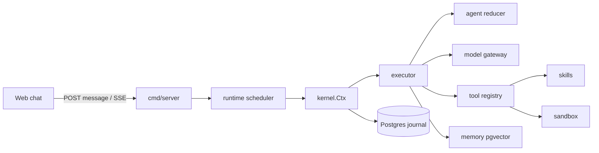

# Requirements

### Overview & Goals
Build solid foundations for a Grok-style agent: durable execution, persistent memory, skills, tool discovery. Order work so each layer is testable before the next depends on it.

### Where we are
- **Real:** `kernel.Ctx` contract (Step/Sleep/Await/Spawn/Now/Rand) in `internal/kernel/kernel.go`; migration `20261119221930_create_kernel.sql` (runs, journal, timers, signals); auth + server in `cmd/server`; Temporal + pgvector in `compose.yml`; web chat UI (`web/src/pages/agent.tsx`) with a fake `runAgent()`.
- **Stubs (TODO only):** `internal/agent` (reducer/events), `internal/executor`, `internal/model/nebius.go`, `internal/tool/*`, `internal/memory/pgvector.go`, `internal/runtime/*`, `memkernel`, `pgkernel`, `temporalkernel`, `conformance`. `skills/` and `sandbox/` are empty.

### Scope
In: backend runtime, persistence, API/streaming to the existing chat UI.
Out (for now): multi-user billing, marketplace of skills, sub-agent swarms, sidebar features (Scheduled/Graph/Extensions pages).

### Functional Requirements
- A chat message starts a durable run that survives worker restarts and streams events to the UI.
- Tool calls are resolved from a registry, with side effects guarded by approvals and idempotency.
- The agent recalls prior conversations and facts across sessions.
- Skills in `skills/` are discovered and loaded on demand; tools are discoverable by relevance, not all stuffed into the prompt.

# Technical Design

### Key Decisions
- **Kernel first, but start on memkernel.** Develop the loop against `memkernel` (in-process) so the agent can work end to end early; the conformance suite in `internal/kernel/conformance` then holds `pgkernel`/`temporalkernel` to the same behavior. Recommended production engine: Temporal (already in compose); `pgkernel` stays the learning/fallback path and should not block product work.
- **Pure reducer + effectful executor** (as already documented): `internal/agent` is `State × Event -> State`, `internal/executor` wires it to `kernel.Ctx`, model and tools. Every model/tool call is a `Step`, so it is journaled.
- **Events are the source of truth.** Persist the run's event stream (new `run_events` table); the UI is a projection over it via SSE, reconnectable with `Last-Event-ID`.
- **Memory in three tiers:** working context (compaction), episodic (conversation/run summaries), semantic (pgvector facts). Memory writes are Steps; retrieval is a tool + automatic recall at turn start.
- **Skills as files, tools as registry.** A skill is a folder with `SKILL.md` (frontmatter name/description); only name+description are in the prompt, the body loads via a `read_skill` tool (progressive disclosure). Tool discovery: registry holds tool definitions with embeddings; a `search_tools` meta-tool returns the top-k, and only those schemas are added to the next model call.

### Architecture Diagram

### Proposed Changes (by phase)
1. **Agent core:** define `State`, `Event`, `Reduce` in `internal/agent`; golden tests. Implement `memkernel`. Implement `model.Client` (Nebius, retry/backoff, usage metering). Implement `executor.Run` as a simple loop: model -> tool calls -> results -> repeat, each as `kernel.StepT`.
2. **Wire to UI:** `run_events` migration; server endpoints to start a run and stream events (SSE); replace `runAgent()` in `agent.tsx` with the stream; render tool calls/activity with existing `components/agents`.
3. **Durability:** `temporalkernel` (workflow, steps, continue-as-new, workers in `cmd/worker-*`) passing `conformance`; chaos tests (kill worker mid-run). Then `runtime`: scheduler budgets/caps, supervisor for stuck runs, approval via `Await`.
4. **Tools:** `tool.Registry` (definition, JSON schema, handler, effect type read/write/destructive), idempotency ledger (`runID:seq` key), approval policy per effect, first tools (web fetch, search, file read), sandbox runner using `sandbox/images`.
5. **Memory:** `memory.Store` on pgvector (migration for `memories` with embedding, scope, source run), `Compact(history)`, recall at turn start, `remember`/`recall` tools, run summaries on completion.
6. **Skills & discovery:** skill loader scanning `skills/`, prompt index, `read_skill`; tool embeddings + `search_tools`; one or two real skills (e.g. hypothesis-research) as the proof.
7. **Observability & evals:** per-run trace view from journal, token/cost metering, a small replayable eval set of hypotheses.

### Risks
- Nondeterminism: model output, time and randomness must go through Steps/`Now()`/`Rand()`.
- Tool side effects are not exactly-once; require idempotency keys.
- Context growth: needs compaction before long runs, and continue-as-new on Temporal.
- Scope creep into `pgkernel`; time-box it.

# Testing

### Validation Approach
- Golden tests for the reducer (no I/O).
- Conformance suite run against memkernel, pgkernel, temporalkernel.
- Chaos test: kill the worker mid-run, confirm the run resumes without repeating completed steps.

### Key Scenarios
- Message -> streamed reply with a tool call, shown in the UI.
- Run resumes after worker restart; the approval `Await` survives restart.
- A fact stated in session A is recalled in session B.
- Skill index appears in the prompt; `read_skill` loads the body; `search_tools` returns a relevant tool.

### Edge Cases
- Replay with a changed step input fails loudly.
- SSE reconnect with `Last-Event-ID` gets no duplicates or gaps.
- Budget exceeded halts the run cleanly.

# Delivery Steps

### ✓ Step 1: Agent core: reducer, memkernel, model client, executor loop
A run can execute a model -> tool -> result loop in-process, journaled via memkernel, with golden tests.

- Define State/Event/Reduce in `internal/agent` with golden tests.
- Implement `internal/kernel/memkernel` and run `conformance` against it.
- Implement `internal/model` Nebius client with retry and usage metering.
- Implement `internal/executor.Run` using `kernel.StepT` for every model and tool call.

Done: `make test` (reducer goldens, memkernel conformance, executor crash-resume + guards), `make smoke` (live Nebius chat + tool call). `/api/chat` runs through the executor on a per-request memkernel.

### ✓ Step 2: Tool registry and first tools
The executor resolves tool calls from a registry with effect types, idempotency keys and approvals.

- 2a ✓ `internal/tool` registry (implements `executor.Tools`) and the first read-only tools: `web_search` (SearXNG, compose) and `browse` (Obscura headless browser over CDP, compose; page → Markdown, private addresses refused). Live smoke tests; worker-loss mid-browse resumes without repeating the model call.
- 2b ✓ `tool.Effect` (Read/Write); approvals via `kernel.Ctx.Await` in the executor (new `waiting` status, `approval_requested`/`approval_decided` events, `POST /api/runs/{id}/approvals`, beUI approval card); idempotency ledger (`tool_ledger`, `Runner.Ledger`); first write tool `submit_form` plus `inspect_forms`. Approval lives in the executor, not `internal/runtime`: it is part of the agent loop.
- 2c ✓ Harness tool extension (modelled on go-bot's harness/tools, for a browser-native agent): per-run browser session (`browser_open/_snapshot/_click/_type/_select/_press/_scroll/_back/_wait/_screenshot`; run ID from the executor, not the model; per-call deadlines; idle reaping), `todo_write`, `ask_user` (durable question via the approval pause), `research` (parallel subagents as child runs), per-run tool budgets, screenshot artifacts. `inspect_forms`/`submit_form` were replaced by the session tools; browser actions run without approval by choice.
- Later from go-bot: `memory` and `session_search` (Step 5), `skill` (Step 6), `schedule` (Step 4), shell/files/jobs (needs the sandbox runner), image reading once the model takes images.
- Later: sandbox runner using `sandbox/images`; interactive browsing (click, type) on Obscura.

### ✓ Step 3: Stream runs to the chat UI
The web agent page shows real streamed agent output instead of the fake reply.

- ✓ Add `run_events` migration and event persistence (`events.append` activity, `(run_id, seq)` key, insert trigger → `NOTIFY`).
- ✓ Add server endpoints to start a run and stream via SSE with Last-Event-ID resume; runs are owned by the user who started them.
- ✓ Replace the blocking `/api/chat` in `web/src/pages/agent.tsx`; render model and tool steps with `AgentActivity`; reattach after a reload.
- ✓ Saved conversations stream through one WebSocket per open chat. Prompts can queue while the agent works, and each queued turn sees the preceding completed turns. The HTTP/SSE run endpoints remain available.
- Later: token-by-token text (activities return complete results).

### * Step 4: Durable execution on Temporal
Runs survive worker crashes and pass the conformance and chaos tests.

- ✓ Implement `temporalkernel` and wire a worker (one `cmd/worker`; steps are named activities, not closures; continue-as-new deferred). See `durability.md`.
- Durable admission, concurrent-run caps, and workflow reconciliation are implemented in `internal/runtime`. The scheduler integration test passed on Postgres 17.
- One-shot, daily, and weekly user schedules deliver durable runs to the original conversation. Account-level spend controls are follow-up work.
- ✓ Add kill-worker chaos test.

Runs from `POST /api/runs` execute on Temporal via `cmd/worker`. Both kernels pass conformance, and the Temporal chaos test covers worker loss. The proposed delivery order for durable admission, supervision, memory, skills, and scheduled runs is in [Memory, skills, and scheduling](memory-skills-and-scheduling.md).

### ✓ Step 5: Persistent memory
The agent recalls facts and summaries across sessions.

- Add an owner-scoped `memories` store with Postgres text search and optional pgvector recall.
- Bound the transcript history and journal the initial memory snapshot in `agent-memory-v1`.
- Offer approval-backed `remember`, `recall`, and `session_search`. Add a memory settings page with deletion and opt-in run summaries.

### ✓ Step 6: Skills and tool discovery
Skills load on demand through `read_skill`. Interactive runs discover
specialized tool groups through `search_tools`.

- ✓ Embed repository skills and list names and descriptions in the model prompt.
- ✓ Ship `hypothesis-research` and pin the catalog in each run's saved workflow input.
- ✓ Ship `agent-discovery-v1` with a small starting tool list and
  deterministic lookup. See [tool discovery](tool-discovery.md) for the
  comparison with the full-registry profile.
