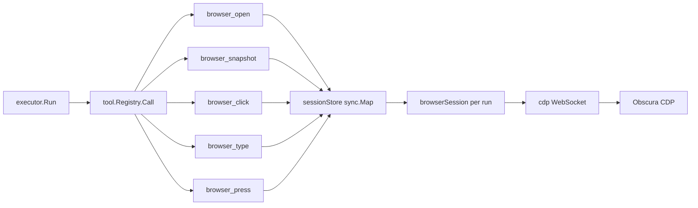

# Requirements

### Overview
Replace the current stateless browser tools (`browse`, `inspect_forms`, `submit_form`) with **session-based interaction tools** that keep a browser page open across multiple tool calls within a single run. This enables the agent to navigate, click, type, and interact with web pages the way a human would — filling forms, clicking buttons, scrolling, and following multi-step flows.

### Goals
- The agent can open a web page, then perform a sequence of actions (click, type, navigate) without reloading the page each time.
- The agent receives an **accessibility snapshot** (indexed list of interactive elements) so it can act by element number instead of guessing CSS selectors.
- Browser interaction tools run autonomously without user approval (phase 1 — permissions to be added later).
- If the worker crashes and loses the browser session, the agent detects it and recovers (by re-opening the page).

### User Stories
- As a user, I want the agent to click "Get in touch" on a portfolio site, then fill out the contact form that appears, so it can interact with sites that use anchors or JavaScript to reveal forms.
- As a user, I want the agent to navigate multi-step flows (e.g., sign-up wizards, checkout flows) without me having to break them into separate runs.

### Scope

**In Scope:**
- `browser_open(url)` — opens a URL in a persistent browser session (Read)
- `browser_snapshot()` — returns page title, URL, Markdown content, and an indexed list of interactive elements like `[3] button "Send"`, `[4] input "Email"` (Read)
- `browser_click(element_index)` — clicks the element at the given index (Read, no approval needed)
- `browser_type(element_index, text)` — types text into the element at the given index (Read, no approval needed)
- `browser_press(key)` — presses a keyboard key (Read, no approval needed)
- Session management: a browser context and page stay open across tool calls within a run
- Session recovery: if a tool call finds the session dead, it returns an error telling the model to call `browser_open` again
- Updated system prompt to describe the new tools
- Increased `MaxToolCalls` and `MaxTurns` defaults to accommodate multi-step browsing
- Register new tools in `cmd/worker`, remove old stateless tools

**Out of Scope:**
- Captcha solving or human-in-the-loop captcha handling (separate issue)
- `browser_scroll`, `browser_select`, `browser_wait` (can be added later; the core tools cover most use cases)
- Full action replay to rebuild a lost session (phase 1: the agent re-opens the page instead)
- Skills integration

# Technical Design

### Current Implementation
`internal/tool/browse.go` provides three stateless tools. Each call:
1. Dials Obscura's CDP WebSocket (`dialCDP`)
2. Creates a fresh browser context (`Target.createBrowserContext`)
3. Creates a target/tab (`Target.createTarget`)
4. Attaches (`Target.attachToTarget`)
5. Navigates (`Page.navigate`) and waits for load
6. Returns Markdown or form info
7. Disposes the context and closes the WebSocket

No state carries over between calls. The `page` struct holds a `*cdp` client, a browser context ID, and a session ID. The `cdp` struct is a single-goroutine CDP client that sends commands and reads responses synchronously.

### Key Decisions

**Session storage: in-memory map keyed by run ID.** The tool registry is created once per worker process. A new `browserSession` struct holds a `*cdp` connection and the browser context + target IDs. A package-level `sync.Map` stores sessions keyed by run ID. When `browser_open(run_id, url)` runs, it creates or reuses the session. Subsequent calls (`browser_snapshot`, `browser_click`, `browser_type`) look up the session by run ID. This keeps sessions isolated per run without leaking between runs.

**Session lifecycle: created by `browser_open`, cleaned up at run end.** The session lives for the duration of the run. When the run completes (or the worker restarts), the session is lost. On worker restart, the journal replays tool calls, but the browser page is gone — `browser_open` re-creates it by navigating to the same URL. This is simpler than action replay and sufficient for phase 1.

**Element indexing: accessibility tree via `DOMSnapshot.captureSnapshot`.** The snapshot returns a tree of nodes with roles, names, and bounding boxes. We flatten interactive nodes (buttons, links, inputs, textareas, selects, forms) into an indexed list. The model acts by index, which is more reliable than CSS selectors.

**Click and type: `Runtime.evaluate` with DOM helpers.** Instead of synthesizing mouse and keyboard events (which requires coordinate calculation and focus management), we use `Runtime.evaluate` to find the element by its data attribute and call `.click()`, `.focus()`, `.value = text`, and dispatch `input`/`change` events. This follows the same pattern as the existing `fillAndSubmitJS`.

**Read effects: `browser_click`, `browser_type`, `browser_press` are Read tools.** They run without user approval, making the agent fully autonomous for browser interactions. Permissions and approval gates will be added in a later phase.

### Proposed Changes

**New file: `internal/tool/session.go`**
- `browserSession` struct: holds `*cdp`, `ctxID`, `targetID`, `sessionID`, and a counter for element indexing
- `sessionStore` (package-level `sync.Map[string, *browserSession]`): maps run ID to session
- `getOrCreateSession(ctx, runID, cdpURL, token)`: looks up or creates a session
- `closeSession(runID)`: disposes the browser context and closes the CDP connection
- `browser_open(run_id, url)`: creates a session, navigates to the URL
- `browser_snapshot(run_id)`: returns page info + indexed element list
- `browser_click(run_id, element_index)`: clicks the element at the index
- `browser_type(run_id, element_index, text)`: types text into the element
- `browser_press(run_id, key)`: presses a keyboard key

**Modified: `internal/tool/browse.go`**
- Remove `Browse`, `InspectForms`, `SubmitForm` constructors (replaced by session tools)
- Keep `dialCDP`, `cdp`, `page.eval`, and `page.markdown()` as internal helpers (renamed to avoid collision)
- The `page` struct becomes part of `browserSession`

**Modified: `internal/executor/executor.go`**
- Update `SystemPrompt` to describe session-based browser tools
- Increase `DefaultLimits.MaxTurns` from 8 to 15 (multi-step browsing needs more turns)
- Increase `DefaultLimits.MaxToolCalls` from 8 to 16 (snapshot + click + type per step)

**Modified: `cmd/worker/main.go`**
- Replace `Browse`, `InspectForms`, `SubmitForm` with new session tools in the registry

### Data Models / Contracts

```
browser_open(run_id: string, url: string) -> string
  "Open a web page in a persistent browser session. Use this first, then act on the page with other browser tools."

browser_snapshot(run_id: string) -> string
  "Return the current page: title, URL, Markdown content, and an indexed list of interactive elements like [3] button \"Send\". Call this after navigation or after an action to see the updated page."

browser_click(run_id: string, element_index: int) -> string
  "Click the element at the given index (from the last snapshot). This can trigger navigation, form submission, or JavaScript actions."

browser_type(run_id: string, element_index: int, text: string) -> string
  "Type text into the element at the given index (from the last snapshot). Use for inputs, textareas, and search fields."

browser_press(run_id: string, key: string) -> string
  "Press a keyboard key (Enter, Tab, Escape, ArrowDown, etc.)."
```

### Architecture Diagram



### Risks
- **Session memory leak:** If a run is long-running, the session holds a WebSocket connection. Mitigation: the session is cleaned up when `browser_open` is called again (reuses the same run ID key), and the worker process cleanup disposes all sessions on shutdown.
- **Element index staleness:** The snapshot returns indices that may shift if the page changes between calls. Mitigation: the model should call `browser_snapshot` after each action to get fresh indices. The system prompt will emphasize this.
- **CDP connection loss:** If Obscura restarts or the WebSocket drops, the session is stale. Mitigation: each tool call checks the connection and returns a clear error if dead, telling the model to call `browser_open` again.

# Delivery Steps

### ✓ Step 1: Create session management and browser_open tool
Add session infrastructure and browser_open to internal/tool/session.go

### ✓ Step 2: Implement browser_snapshot with indexed interactive elements
Add browser_snapshot with element indexing

### ✓ Step 3: Implement browser_click, browser_type, and browser_press
Add click, type, and press interaction tools

### ✓ Step 4: Wire up tools, update system prompt, remove old tools, increase limits
Wire up new tools, update prompt, remove old tools, increase limits